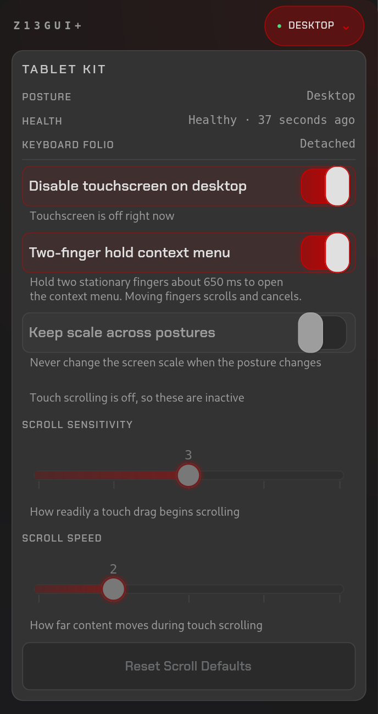

# Z13 Tablet Kit — Linux Tablet Mode for the ASUS ROG Flow Z13

<div align="center">

[](#requirements)
[](#requirements)
[](#install)
[](https://aur.archlinux.org/packages/z13-tablet-kit)
[](#verify)

[Features](#features) •
[Quick start](#quick-start) •
[Posture model](#posture-model) •
[The stack](#the-stack) •
[Components](#components) •
[Requirements](#requirements) •
[Install](#install) •
[Uninstall](#uninstall) •
[Tips](#tips)

</div>



A posture-aware tablet mode for the **2025 ASUS ROG Flow Z13 (GZ302, AMD Strix Halo)** 3-in-1 on
**Linux with KDE Plasma 6 / Wayland**. It detects whether the Z13 is **docked**, used as a
**laptop** with the keyboard folio, or held as a **tablet**, and adapts the touchscreen,
display scale, auto-rotate and on-screen keyboard to match. No kernel patches; the only
root-owned pieces are two udev rules and a login-screen config file.

It should run on any distro with Plasma 6 / Wayland and systemd. The install steps target
Arch / CachyOS. The screenshot shows the kit's settings in the optional
[`z13gui-plus`](#z13gui-plus) drawer.

> [!NOTE]
> **On GNOME?** The companion [`z13ctl-plus`](#the-stack) daemon and `z13gui-plus` drawer
> run there too (GNOME support in the drawer is an untested beta), but this kit does not:
> it controls touch, scale and the on-screen keyboard through KWin, so posture handling
> needs Plasma.

## Features

- **Automatic 3-mode posture** — desktop, laptop and tablet, detected from the dock hub, the
  folio and the connected displays the moment something is plugged in or unplugged.
- **Auto-rotate that only rotates in tablet mode** — via a virtual `SW_TABLET_MODE` switch the
  GZ302 firmware advertises but never emits.
- **On-screen keyboard that never covers the folio** — on in tablet mode, forced off in laptop
  and desktop posture.
- **Two-finger scroll in any app** — terminals, TUIs, browsers, document viewers.
- **Touch right-click** — a two-finger hold opens a context menu, which KDE Wayland has no
  touch gesture for.
- **Tablet scaling** — each posture remembers its scale; defaults are `1.75` in tablet
  posture and `1.5` docked and as a laptop.
- **Folio touchpad fix** — the jumpy touchpad is inhibited by default, with a guarded opt-in.
- **Live settings, no restarts** — toggles in the optional `z13gui-plus` drawer apply instantly.

<br clear="right">

## Quick start

Arch / CachyOS (AUR), as your normal user. Stop any other Z13 hardware daemon first.

```bash
paru -S z13-tablet-kit iio-sensor-proxy   # pulls in z13ctl-plus-bin; optional: z13gui-plus-bin
systemctl --user enable --now z13ctl-plus.socket z13ctl-plus.service
systemctl --user enable --now z13-tablet-switch.service z13-touch-scroll.service
```

Then enable auto-rotate once: **Quick Settings → Auto-rotate → right-click → "Rotate only in
tablet mode"**, and reboot (or re-attach the folio) so the folio touchpad rule applies.

Other distros: see [Install from source](#install-from-source).

## Posture model

| Posture | Detected by | Touch | Tablet mode | Auto-rotate | Virtual keyboard |
|---|---|---|---|---|---|
| **desktop** | dock hub `0b05:1ac1` or any external monitor | off¹ | off | off | off |
| **laptop** | folio `0b05:1a30`, no dock | on | off | off | off |
| **tablet** | neither | on | **on** | **on** | **on** |

¹ Unless **Disable touchscreen on desktop** is turned off in `z13gui-plus`.

Priority: desktop > laptop > tablet. Attaching the folio never triggers tablet features.
The virtual keyboard (plasma-keyboard / maliit) is forced off in laptop and desktop posture, so
it never pops up over the folio or a dock. Posture is detected from the folio, the dock hub and
connected displays, not from keyboards: a Bluetooth keyboard on a bare tablet still gets the
on-screen keyboard, and a tablet on a TV is `desktop` (touch off unless you turn off
**Disable touchscreen on desktop**).

## The stack

This kit is one of three cooperating repos that run on the same machine:

| Repo | Role |
|---|---|
| [z13-tablet-kit](https://github.com/aic0d3r/z13-tablet-kit) | posture detection and touch input — **this repo** |
| [z13ctl-plus](https://github.com/aic0d3r/z13ctl-plus) | daemon that owns display state and persists tablet settings (**required**) |
| [z13gui-plus](https://github.com/aic0d3r/z13gui-plus) | optional GTK4 overlay drawer: live posture/health chip and tablet settings (also runs on GNOME, in beta) |

How they work together:

1. `z13-tablet-switch` detects dock/folio/tablet posture and applies it through
   `dock` (touchscreen toggle, virtual tablet-mode switch).
2. `dock` publishes posture to the `z13ctl-plus` daemon, which serializes scale
   and rotation changes via `kscreen-doctor`, restoring the scale last used in each posture.
3. `z13gui-plus` shows the live posture/health chip and exposes the tablet
   settings: **Disable touchscreen on desktop**, **Two-finger hold context menu**,
   **Keep scale across postures**, the folio touchpad opt-in, and scroll sensitivity
   and speed.
4. `z13ctl-plus` persists those settings and projects them to
   `$XDG_RUNTIME_DIR/z13ctl-plus/tablet-settings.json`; `z13-tablet-switch` and
   `z13-touch-scroll` read the projection and apply changes live, without
   restarts.

> [!NOTE]
> Ownership is one-directional: only the kit writes the posture file, only `z13ctl-plus`
> writes tablet settings, and the GUI is a read/write client of the daemon. No repo reaches
> into another's state directly.

## Components

| Component | Runs as | Job |
|---|---|---|
| [`z13-tablet-switch`](#z13-tablet-switch) | user service | detects posture, owns the virtual tablet-mode switch |
| [`dock`](#dock) | called by the switch | applies posture: touchscreen, OSK mode, publish to `z13ctl-plus` |
| [`z13-touch-scroll`](#z13-touch-scroll) | user service | two-finger scroll and right-click |
| [Auto-rotate](#auto-rotate) | Plasma | rotation, gated on tablet mode |
| [On-screen keyboard](#on-screen-keyboard) | Plasma | OSK, gated on posture |
| [Folio touchpad](#folio-touchpad) | udev rule | inhibited by default |
| [`z13ctl-plus`](#z13ctl-plus-display-coordinator) | user daemon | scale and refresh changes, persists settings |
| [`z13gui-plus`](#z13gui-plus) | optional GUI | live status and settings |

### `z13-tablet-switch`

Watches the dock hub, folio, and DRM connectors and calls `dock` when posture changes. It
sleeps on kernel hotplug uevents and an inotify watch on the settings file instead of polling,
sends a lightweight heartbeat to `z13ctl-plus` every 45 seconds, retries a failed apply every
10 seconds, and re-applies posture every 5 minutes to recover from KWin or `z13ctl-plus`
restarts. Any non-eDP display counts as `desktop`, so any USB-C dock or HDMI cable works.

It also creates a virtual `SW_TABLET_MODE` uinput switch that is on only in tablet posture. The
GZ302's WMI path advertises the switch but never emits it, so Plasma otherwise has nothing to
gate "rotate only in tablet mode" on.

Runs as a **user service**; logind grants `/dev/uinput` to the active session. The on-screen
keyboard remains a separate Plasma setting that needs no tablet-mode signal. (Plasma 6.7
intentionally dropped the old "force bigger UI in tablet mode" behavior,
[bugs.kde.org #521550](https://bugs.kde.org/show_bug.cgi?id=521550).)

### `dock`

Applies the posture supplied by `z13-tablet-switch`: it toggles the internal touchscreen
(ELAN9008) through KWin D-Bus, sets the on-screen keyboard mode, and publishes posture to
`z13ctl-plus`.

### `z13-touch-scroll`

Reads the ELAN9008 touchscreen, detects two-finger vertical swipes, and injects mouse-wheel
events via evdev UInput. Works in **any** app: terminal scrollback, TUIs, browsers, and document
viewers. It stays idle in desktop posture while **Disable touchscreen on desktop** is on. With
**Two-finger hold context menu** enabled, a stationary two-finger hold moves the pointer to the
touch point and right-clicks, since KDE Wayland has no touch right-click.

### Auto-rotate

Plasma-native, gated on the virtual `SW_TABLET_MODE` switch above. `iio-sensor-proxy` (default
on CachyOS) reads the accelerometer. No separate rotation daemon is needed; just enable
"Rotate only in tablet mode" once (see [Quick start](#quick-start)).

### On-screen keyboard

`plasma-keyboard` (ships with Plasma 6.7, recommended) or `maliit-keyboard` (AUR, legacy
alternative); it pops up when a text field gets touch focus. The kit gates it on posture:
`TouchOnly` in tablet mode, forced `Off` in laptop and desktop posture
(KWin would otherwise pop the OSK on any touch device). It also restarts the keyboard on every
posture change, because the keyboard caches output geometry and would otherwise clip its keys
after a screen or scale switch.

The kit also enables `plasma-keyboard` on the SDDM login screen, so you can sign in without
the folio: tap the keyboard button in the bottom-left corner. It adds an SDDM config file
(`/etc/sddm.conf.d/10-z13-osk.conf` from `install.sh`,
`/usr/lib/sddm/sddm.conf.d/zzz-z13-osk.conf` from the AUR package) that starts the login
screen's KWin with `--inputmethod plasma-keyboard`. Because SDDM can't add a flag to the
existing command, the file repeats the stock CachyOS compositor command. If you already
customize `CompositorCommand`, add the flag to your own file instead. `install.sh` skips this
step when `plasma-keyboard` isn't installed.

### Folio touchpad

Inhibited by default via udev, because its firmware emits jumping-cursor events that libinput
cannot filter. Members of `users` can opt back in through `z13gui-plus`, which shows a warning
each time.

### `z13ctl-plus` display coordinator

[`z13ctl-plus`](https://github.com/aic0d3r/z13ctl-plus) owns scale and refresh changes. On a posture
change it restores the scale last used in that posture (defaults: desktop/laptop `1.5`, tablet
`1.75`), so a scale you set in System Settings sticks to that posture. Turn on **Keep scale
across postures** to stop scale changes entirely. Plasma keeps the tablet rotation unless an
explicit rotation is requested. The kit itself never changes outputs with `kscreen-doctor`; it
only reads rotation and scale to place touch context-menu clicks. Desktop posture waits ten
seconds for the display topology to settle, and external outputs stay under KDE's control.

### `z13gui-plus`

[`z13gui-plus`](https://github.com/aic0d3r/z13gui-plus) (optional) adds a **Tablet Kit** card
(pictured at the top) while the kit is running: live posture, health and folio status, the
**Disable touchscreen on desktop**, **Two-finger hold context menu** and **Keep scale across
postures** toggles, the guarded folio-touchpad opt-in, and 1–5 **Scroll sensitivity** and
**Scroll speed** sliders. `z13ctl-plus` persists the settings, and they apply without restarts.

## Requirements

- KDE Plasma 6 / Wayland and systemd (`kscreen-doctor`, `qdbus6`, and `gdbus`). GNOME and
  other desktops aren't supported: posture, touch and OSK control go through KWin.
- `iio-sensor-proxy` (default on CachyOS) — for Plasma auto-rotate.
- `z13ctl-plus` (v2.2.1 or newer) with its user socket enabled.
- Membership in `users` (configured by `z13ctl-plus setup`) for the folio-touchpad opt-in.
- `python-evdev` (official repo) — for the uinput switch and touch scroll.
- `plasma-keyboard` (included with Plasma 6.7, recommended) for the OSK and the login-screen
  keyboard (the AUR package depends on it), or `maliit-keyboard` (AUR) as a legacy
  alternative in the session only.
- No extra groups or root daemon for input: logind grants `/dev/uinput` to the active
  graphical session, and a udev `uaccess` rule grants touchscreen read access. That rule means
  any program you run can read raw touch positions, including taps on the on-screen keyboard.

## Install

> [!IMPORTANT]
> **`z13ctl-plus` (the display/settings daemon) is a hard dependency.** The AUR package
> pulls it in; from source, install it first. `z13gui-plus` is optional (a touch overlay for
> the same settings).

### AUR (Arch / CachyOS, recommended)

Follow [Quick start](#quick-start). Updates arrive with your normal system update. If you
used `install.sh` before, run its `./uninstall.sh` first: the copies in `~/.local` would
override the package.

### Install from source

For other distros, or to run `master`.

1. **Prerequisites:** `python-evdev` and `iio-sensor-proxy`
   (Arch: `sudo pacman -S python-evdev iio-sensor-proxy`; use your distro's package
   manager elsewhere). For the on-screen keyboard, `plasma-keyboard` ships with Plasma 6.7;
   install `maliit-keyboard` (AUR) only if you prefer the legacy one.
2. **`z13ctl-plus`** from its release tarball:

   ```bash
   wget https://github.com/aic0d3r/z13ctl-plus/releases/download/v2.2.1/z13ctl-plus_2.2.1_linux_amd64.tar.gz
   tar xzf z13ctl-plus_2.2.1_linux_amd64.tar.gz
   sudo install -Dm755 z13ctl-plus /usr/local/bin/z13ctl-plus
   sudo z13ctl-plus setup
   systemctl --user enable --now z13ctl-plus.socket z13ctl-plus.service
   ```

3. **The kit:**

   ```bash
   git clone https://github.com/aic0d3r/z13-tablet-kit
   cd z13-tablet-kit
   ./install.sh
   ```

   `install.sh` is safe to re-run. It installs the posture manager, touch scroll, their user
   services, the udev rules, and the login-screen keyboard config, then starts everything. To update:
   `git pull && ./install.sh`.

### Post-install (one-time)

- **Log out and back in** if prompted. The `users` group membership added by
  `z13ctl-plus setup` takes effect at login and is needed for the folio-touchpad opt-in.
- **Enable auto-rotate once:** Quick Settings → Auto-rotate → right-click →
  "Rotate only in tablet mode". The kit's virtual `SW_TABLET_MODE` gates it.

### Verify

```bash
systemctl --user status z13-tablet-switch z13-touch-scroll
cat "$XDG_RUNTIME_DIR/z13-tablet-kit/posture"   # one of: desktop / laptop / tablet
```

- Logs: `journalctl --user -u z13-tablet-switch`
- Tests (offline, no hardware needed): `python3 -m unittest discover tests`

## Uninstall

**AUR:** stop the kit and reset the display before removing the package:

```bash
systemctl --user disable --now z13-tablet-switch.service z13-touch-scroll.service
/usr/lib/z13-tablet-kit/dock laptop      # touchscreen on, on-screen keyboard off
z13ctl-plus display rotation none
sudo pacman -R z13-tablet-kit
```

Then re-check System Settings → Keyboard → Virtual Keyboard: the package can't restore the
mode you had before.

**From source:**

```bash
cd z13-tablet-kit
./uninstall.sh
```

This returns to laptop defaults (normal rotation, touchscreen on), re-enables the folio
touchpad, and restores the on-screen keyboard mode recorded by the first `install.sh` run.
Installs older than that record print a reminder to re-check it in System Settings. The OSK
package stays installed.

## Tips

- **Touch scrolling:** a two-finger vertical swipe scrolls any focused app (terminal,
  browser, TUI). In `z13gui-plus`, **Scroll sensitivity** sets how readily a drag starts
  scrolling and **Scroll speed** how far content moves (1–5, defaults 3 and 2; **Reset
  Scroll Defaults** restores them).
- **Touch context menus:** a stationary two-finger hold (~650 ms) moves the pointer to the
  touch point and sends a real right-click; moving either finger cancels it and scrolls.
  Known limit: with touch enabled in desktop posture and a monitor placed left of or above
  the built-in panel, the click lands offset onto that monitor.
- **Page Up/Down without dedicated keys:** the Z13 folio keyboard has no Page Up/Down
  keycaps, but **Fn+Up / Fn+Down** are mapped in firmware and work everywhere.
- **Three-finger gestures** are reserved by KWin (overview, virtual desktop switching), so
  touch scroll deliberately uses two fingers.
- **Auto-rotate:** driven by Plasma + `iio-sensor-proxy`, gated by the virtual tablet-mode
  switch. If a portrait orientation comes out mirrored on your unit, that's a sensor-mount
  quirk to fix in `iio-sensor-proxy`, not in this kit.
- Configure optional edge gestures in **System Settings → Workspace → Touchscreen Gestures**.

## Say thanks

If the tablet kit makes your Z13 nicer to use as a tablet, [star it on GitHub](https://github.com/aic0d3r/z13-tablet-kit). That helps other Z13 owners find it. If you want to chip in, you can [sponsor me on GitHub](https://github.com/sponsors/aic0d3r).

## License

[Apache-2.0](LICENSE)
